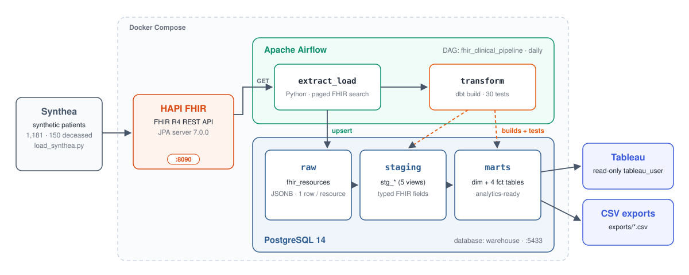
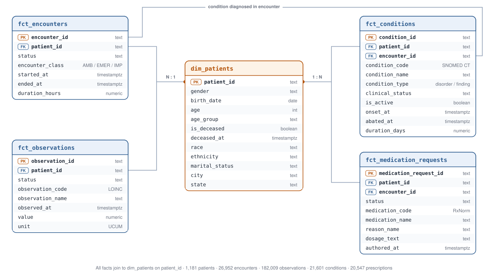

# FHIR Clinical Data Pipeline

An end-to-end clinical data engineering project. Synthetic patient records are
exchanged as **HL7 FHIR R4** resources, extracted from a FHIR server by
**Apache Airflow**, landed as raw JSON in **PostgreSQL**, and modelled with
**dbt** into analytics-ready tables.

> **Synthetic data only.** All records are generated by [Synthea](https://github.com/synthetichealth/synthea).
> Never load real patient data into this project.

## Architecture

<p align="center">
  
</p>

One PostgreSQL 14 instance hosts three databases: `hapi` (the FHIR server's
storage), `warehouse` (analytics) and `airflow` (Airflow metadata).

## Tech stack

| Layer          | Technology                       |
|----------------|----------------------------------|
| Synthetic data | Synthea                          |
| FHIR server    | HAPI FHIR JPA Server 7.0.0 (R4)  |
| Database       | PostgreSQL 14                    |
| Orchestration  | Apache Airflow 3.2.2             |
| Extract/load   | Python 3.12, requests, psycopg2  |
| Transform      | dbt Core + dbt-postgres 1.9.0    |
| Runtime        | Docker Compose                   |

## Interoperability

| FHIR resource       | Represents                    | Rows    | Terminology              |
|---------------------|-------------------------------|--------:|--------------------------|
| `Patient`           | Demographics, birth and death | 1,181   | n/a                      |
| `Encounter`         | Visits                        | 26,952  | HL7 ActCode, SNOMED CT   |
| `Observation`       | Vitals, labs, surveys         | 182,009 | LOINC, UCUM              |
| `Condition`         | Diagnoses                     | 21,601  | SNOMED CT                |
| `MedicationRequest` | Prescriptions                 | 20,547  | RxNorm                   |

`Medication` (6,613 rows) is also extracted, because some prescriptions reference
the drug instead of embedding it. The current dataset has 1,181 patients:
1,031 living and 150 deceased.
Synthea output also follows the US Core profiles. It includes other
resources (Procedure, Immunization, Claim and more); to extract one, add it to
`RESOURCE_TYPES` in [`extract_load.py`](airflow/pipeline/extract_load.py).

## Data model

<p align="center">
  
</p>

Notes for analysis:
- `age` is age at death for deceased patients, otherwise age at the latest build.
- `condition_type` is the SNOMED CT semantic tag. Filter on `disorder` for clinical
  diagnoses; `finding` and `situation` include social factors such as employment
  and stress.
- About 22% of observations, such as surveys, smoking status and blood-pressure
  panels, have no single numeric `value`.
- Names, street addresses, phone numbers and MRNs are deliberately left out of the models.

| Layer     | Object                       | Purpose                                              |
|-----------|------------------------------|------------------------------------------------------|
| `raw`     | `fhir_resources` (table)     | Full FHIR JSON, one row per resource, keyed on `(resource_type, resource_id)` |
| `staging` | `stg_*` (views)              | FHIR fields extracted and typed                      |
| `marts`   | `dim_*`, `fct_*` (tables)    | Analytics-ready, read by BI tools                    |

Each layer uses its own least-privilege account: `etl_user` writes `raw`,
`dbt_user` builds `staging` and `marts`, and `tableau_user` can only read `marts`.

## Quick start

Prerequisites: Docker Desktop, Java 17+ (for Synthea), Python 3.

```bash
cp .env.example .env                 # set every password
docker compose up -d --build
curl http://localhost:8090/fhir/metadata
```

| Service      | Address                                  |
|--------------|------------------------------------------|
| HAPI FHIR    | http://localhost:8090/fhir               |
| Airflow      | http://localhost:8091 (user `admin`)     |
| PostgreSQL   | `localhost:5433`, database `warehouse`   |

Airflow password: `docker exec fhir-clinical-pipeline-airflow-1 cat /opt/airflow/simple_auth_manager_passwords.json.generated`

## Running the pipeline

**1. Generate patients**

```bash
curl -L -o tools/synthea-with-dependencies.jar \
  https://github.com/synthetichealth/synthea/releases/download/master-branch-latest/synthea-with-dependencies.jar

java -jar tools/synthea-with-dependencies.jar -p 1350 -s 42 -a 18-90 --generate.only_alive_patients true \
  --exporter.years_of_history 2 --exporter.baseDirectory ./data/synthea/alive Massachusetts
java -jar tools/synthea-with-dependencies.jar -p 150 -s 43 -a 18-90 --generate.only_dead_patients true \
  --exporter.years_of_history 2 --exporter.baseDirectory ./data/synthea/dead Massachusetts
```

**2. Load into FHIR**

```bash
python3 scripts/load_synthea.py
```

The loader uploads the hospital and practitioner bundles first, then the patient
bundles in parallel. It records each finished file in `data/synthea/.uploaded.txt`
and skips recorded files on a re-run, so you can stop and restart it without
creating duplicates.

**3. Run the DAG.** Trigger `fhir_clinical_pipeline` in the Airflow UI, or run:

```bash
docker exec fhir-clinical-pipeline-airflow-1 airflow dags trigger fhir_clinical_pipeline
```

`extract_load` pages through each resource type and upserts it into `raw`;
`transform` runs `dbt build` to build the models and run the tests.

**4. Query**

```sql
SELECT encounter_class, COUNT(*), ROUND(AVG(duration_hours), 1) AS avg_hours
FROM marts.fct_encounters GROUP BY 1 ORDER BY 2 DESC;
```

**5. Export reports to CSV (optional)**

```bash
mkdir -p exports
for t in dim_patients fct_encounters fct_observations fct_conditions fct_medication_requests; do
  docker exec fhir-clinical-pipeline-db-1 psql -U admin -d warehouse \
    -c "\copy marts.$t TO STDOUT WITH CSV HEADER" > exports/$t.csv
done
```

This writes one CSV per mart table to `exports/`. A snapshot of the current
dataset is included in the repo, so you can download the reports without
running the pipeline. Re-run the export after each pipeline run to refresh it.

## Data quality

- **30 dbt tests** run on every DAG run: unique, non-null primary keys, every fact linked to a patient, and only known gender values. A failing test fails the DAG.
- **Idempotent loads:** re-runs upsert on `(resource_type, resource_id)`, so they never create duplicates.

## Project structure

```
├── docker-compose.yml        # db, fhir, airflow
├── hapi.application.yaml     # HAPI config (Postgres dialect, R4)
├── .env.example              # secrets template
├── airflow/
│   ├── dags/fhir_clinical_pipeline.py
│   ├── pipeline/extract_load.py
│   └── dbt/models/{staging,marts}/
├── scripts/load_synthea.py   # bulk FHIR loader
├── sql/bootstrap/            # databases, schemas, roles (first start only)
├── data/synthea/             # generated bundles (git-ignored)
├── exports/                  # CSV snapshot of the mart tables
├── docs/images/              # README diagrams (SVG)
└── tools/                    # Synthea jar (git-ignored)
```

## Design decisions

- **ELT into one JSONB table:** raw FHIR is kept exactly as received, so models can be rebuilt without re-extracting.
- **`_offset` paging:** HAPI 7.0.0's normal paging stops at 3,000 results.
- **Least-privilege roles:** separate accounts for loading, transforming and BI.

## Roadmap

- Reconciliation and business-rule tests, plus pytest for the extractor
- Incremental extraction with `_lastUpdated`
- De-identification layer and Tableau dashboards
